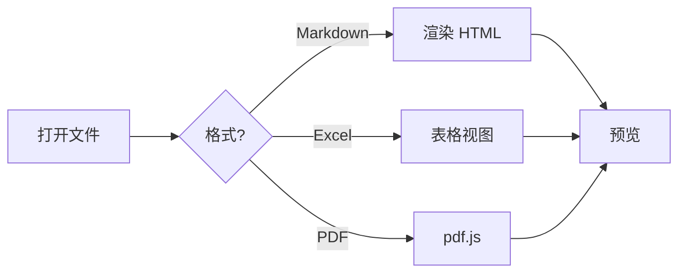
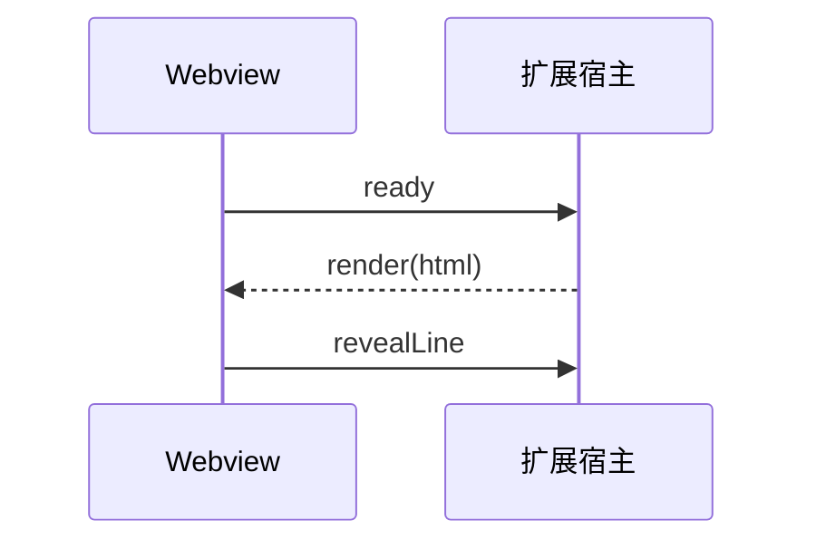

# DocsView Markdown 示例


一段包含 **粗体**、*斜体*、~~删除线~~、`行内代码` 和[外部链接](https://code.visualstudio.com)的文字，以及指向[另一个文件](people.csv)的相对链接。跳到[数学公式](#数学公式)。

## 任务列表

- [x] Markdown 预览
- [x] 表格编辑
- [ ] 待办事项

## 表格

| 格式 | 预览 | 编辑 |
| :--- | :---: | ---: |
| Markdown | ✅ | 文本 |
| CSV | ✅ | ✅ |
| Excel | ✅ | ✅ |

## 代码

```ts
interface User {
  id: number;
  name: string;
}

export function greet(user: User): string {
  // 返回问候语
  return `Hello, ${user.name}!`;
}
```

```python
def fib(n: int) -> int:
    return n if n < 2 else fib(n - 1) + fib(n - 2)
```

## 流程图





## 数学公式

行内公式 $E = mc^2$，以及块级公式：

$$
\int_{-\infty}^{\infty} e^{-x^2}\,dx = \sqrt{\pi}
$$

## 引用与脚注

> 好的工具让复杂的事情变简单。[^1]

[^1]: 这是一个脚注。

---

### 小节 1

这是用于测试滚动同步的第 1 段填充内容。Lorem ipsum dolor sit amet, consectetur adipiscing elit, sed do eiusmod tempor incididunt ut labore et dolore magna aliqua.

### 小节 2

这是用于测试滚动同步的第 2 段填充内容。Lorem ipsum dolor sit amet, consectetur adipiscing elit, sed do eiusmod tempor incididunt ut labore et dolore magna aliqua.

### 小节 3

这是用于测试滚动同步的第 3 段填充内容。Lorem ipsum dolor sit amet, consectetur adipiscing elit, sed do eiusmod tempor incididunt ut labore et dolore magna aliqua.

### 小节 4

这是用于测试滚动同步的第 4 段填充内容。Lorem ipsum dolor sit amet, consectetur adipiscing elit, sed do eiusmod tempor incididunt ut labore et dolore magna aliqua.

### 小节 5

这是用于测试滚动同步的第 5 段填充内容。Lorem ipsum dolor sit amet, consectetur adipiscing elit, sed do eiusmod tempor incididunt ut labore et dolore magna aliqua.

### 小节 6

这是用于测试滚动同步的第 6 段填充内容。Lorem ipsum dolor sit amet, consectetur adipiscing elit, sed do eiusmod tempor incididunt ut labore et dolore magna aliqua.

### 小节 7

这是用于测试滚动同步的第 7 段填充内容。Lorem ipsum dolor sit amet, consectetur adipiscing elit, sed do eiusmod tempor incididunt ut labore et dolore magna aliqua.

### 小节 8

这是用于测试滚动同步的第 8 段填充内容。Lorem ipsum dolor sit amet, consectetur adipiscing elit, sed do eiusmod tempor incididunt ut labore et dolore magna aliqua.

### 小节 9

这是用于测试滚动同步的第 9 段填充内容。Lorem ipsum dolor sit amet, consectetur adipiscing elit, sed do eiusmod tempor incididunt ut labore et dolore magna aliqua.

### 小节 10

这是用于测试滚动同步的第 10 段填充内容。Lorem ipsum dolor sit amet, consectetur adipiscing elit, sed do eiusmod tempor incididunt ut labore et dolore magna aliqua.

### 小节 11

这是用于测试滚动同步的第 11 段填充内容。Lorem ipsum dolor sit amet, consectetur adipiscing elit, sed do eiusmod tempor incididunt ut labore et dolore magna aliqua.

### 小节 12

这是用于测试滚动同步的第 12 段填充内容。Lorem ipsum dolor sit amet, consectetur adipiscing elit, sed do eiusmod tempor incididunt ut labore et dolore magna aliqua.

